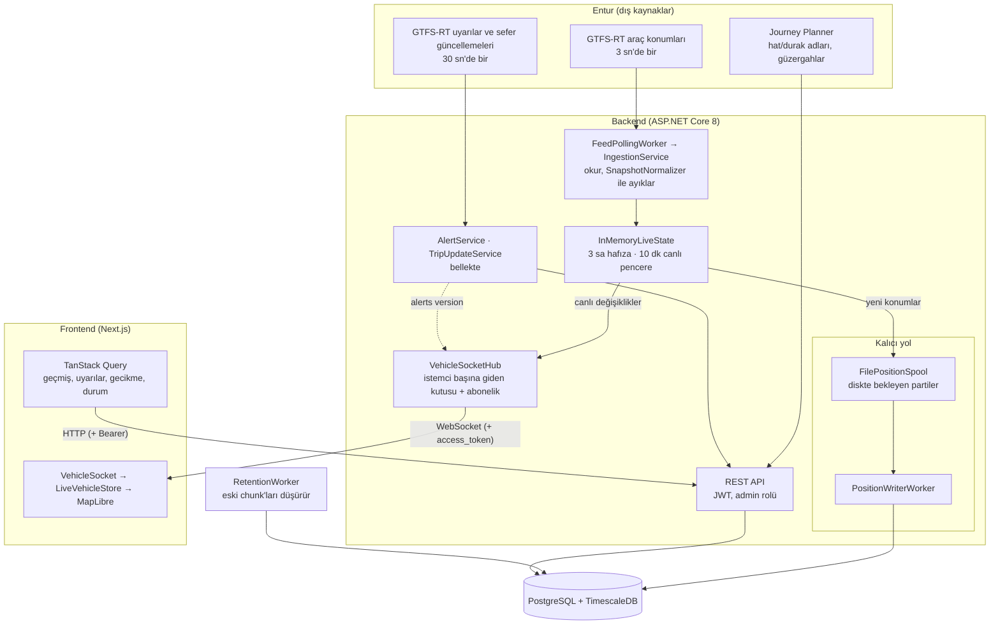

# Canlı Araç Takip Platformu

Norveç'in ulusal toplu taşıma platformu Entur'un GTFS-Realtime araç konum akışını 3 saniyede bir okuyan, son 3 saatin verisini saklayan ve WebSocket ile yayınlayan bir backend ile bu veriyi canlı harita, araç geçmişi ve sistem durumu ekranlarında gösteren bir web arayüzü.

**Tanıtım videosu:** _eklenecek_

## İçindekiler

1. [Çalıştırma](#çalıştırma)
2. [Mimari ve veri akışı](#mimari-ve-veri-akışı)
3. [Gerçek veriden gözlemler](#gerçek-veriden-gözlemler)
4. [Saklama ve silme](#saklama-ve-silme)
5. [Veri kaybı senaryoları](#veri-kaybı-senaryoları)
6. [Canlı yayın (WebSocket)](#canlı-yayın-websocket)
7. [Arayüzde veri nerede duruyor](#arayüzde-veri-nerede-duruyor)
8. [Hat ve durak adları, planlanan güzergah](#hat-ve-durak-adları-planlanan-güzergah)
9. [Uyarılar ve sefer takibi](#uyarılar-ve-sefer-takibi)
10. [Kimlik doğrulama](#kimlik-doğrulama)
11. [Ölçümler](#ölçümler)
12. [Ölçeklenince ne olur](#ölçeklenince-ne-olur)
13. [Testler](#testler)
14. [Bilinen eksikler](#bilinen-eksikler)
15. [Yapay zeka kullanımı ve commit geçmişi](#yapay-zeka-kullanımı-ve-commit-geçmişi)

## Çalıştırma

Gereken tek şey Docker.

```bash
docker compose up --build
```

`.env` dosyası gerekmez: her ayarın yerel geliştirme için bir varsayılanı var. Değiştirmek için `.env.example`'ı `.env` olarak kopyalayıp düzenleyin (akış adresleri, okuma aralıkları, saklama süresi, canlı harita penceresi, portlar, imza anahtarı, admin hesabı). Repoda gerçek parola ya da anahtar yoktur; `.env` git'e girmez.

**Giriş:** uygulama üyelik ister. Açılışta bir admin hesabı oluşturulur: `admin@vehicle-tracking.local` / `admin12345` (yalnızca geliştirme varsayılanı; `AUTH_ADMIN_EMAIL` / `AUTH_ADMIN_PASSWORD` ile değişir). Giriş ekranından yeni kullanıcı da kaydolabilir; sistem durumu ekranını yalnızca admin görür.

| Adres | Ne |
|---|---|
| http://localhost:3000 | Arayüz: canlı harita, `/tr/alerts` uyarılar, `/tr/status` sistem durumu (admin) |
| http://localhost:8080/swagger | REST uç noktaları; önce `POST /api/auth/login`, sonra "Authorize" ile token |
| http://localhost:8080/health | Süreç ayakta mı (girişsiz) |
| http://localhost:8080/health/ready | Akış okunuyor mu, veritabanına ulaşılıyor mu, nedenleriyle (girişsiz) |
| `ws://localhost:8080/ws/vehicles?access_token=…` | Canlı yayın |

Backend ayağa kalkar kalkmaz veri toplamaya başlar; veritabanı şeması ilk açılışta kendiliğinden oluşur. Hat ve durak adları ilk dakikalarda dolar; demo için yığını birkaç dakika önceden başlatmak iyi olur.

Temiz bir klonda, `.env` olmadan ve Docker'ın varsayılan köprü ağıyla denendi: yığın kendiliğinden ayağa kalkar, veri toplamaya başlar ve uçtan uca testlerin hepsi geçer.

> **Konteynerler internete çıkamıyorsa.** Bazı Linux kurulumlarında Docker'ın köprü ağı dışarıya kapalıdır. Bu durumda derleme paket indiremez ve backend Entur'a ulaşamaz. Bunun için her şeyi ana makinenin ağında çalıştıran isteğe bağlı bir dosya var:
>
> ```bash
> docker compose -f docker-compose.yml -f docker-compose.hostnet.yml up --build
> ```

**Docker'sız geliştirme.** Veritabanı TimescaleDB eklentisi istediği için en kolayı yalnızca onu Docker'da çalıştırmaktır; backend .NET 8 SDK, arayüz Node 22 ister.

```bash
docker compose up -d db

# backend (ayrı terminal); bağlantı dizesi bilerek appsettings'te yok
cd backend
ConnectionStrings__Database="Host=localhost;Port=5432;Database=vehicle_tracking;Username=vehicle_tracking;Password=vehicle_tracking" \
  dotnet run --project src/VehicleTracking.Api --urls http://localhost:8080

# arayüz (ayrı terminal)
cd frontend && npm ci && npm run dev
```

`--urls` gerekli: arayüz backend'i 8080'de arar ve CORS yalnızca `localhost:3000`'e açıktır.

## Mimari ve veri akışı



Verinin iki yolu vardır ve birbirlerini beklemezler:

- **Canlı yol** tamamen bellektedir: normalizasyon → canlı durum → istemcilerin giden kutusu. Veritabanına dokunmaz.
- **Kalıcı yol** diskten geçer: değişen konumlar önce dosyaya, oradan veritabanına yazılır.

Bu ayrım sayesinde veritabanı durduğunda harita canlı kalır; bir istemci yavaşladığında da yazma etkilenmez.

Akışların adım adım çizimleri (okuma döngüsü, canlı pencere, WebSocket ve abonelik, yavaş istemci, veritabanı kesintisi, silme, kimlik doğrulama, uyarılar ve sefer takibi) [docs/architecture.md](docs/architecture.md) dosyasındadır.

### Backend katmanları

Bağımlılıklar içe doğrudur: `Domain` hiçbir şeye bağlı değildir, `Application` yalnızca `Domain`'e, `Infrastructure` `Application`'a bağlıdır. `Api` iş kuralları için `Application`'ı kullanır; `Infrastructure`'ı yalnızca açılışta servisleri kaydetmek için bilir (composition root). Application'ın ihtiyaç duyduğu dış dünya (akış, veritabanı, disk) Application'da arayüz olarak tanımlanır ve Infrastructure'da uygulanır.

Bu kurallar [mimari testleriyle](backend/tests/VehicleTracking.ArchitectureTests/ArchitectureTests.cs) zorlanır; ihlal `dotnet test`'i düşürür:

1. Domain; Application, Infrastructure ve Api'ye bağımlı değil.
2. Application; Infrastructure ve Api'ye bağımlı değil.
3. Application; ASP.NET Core'a ve JWT/Identity kütüphanelerine bağımlı değil.
4. Infrastructure, Api'ye bağımlı değil.
5. Controller'lar Infrastructure'a ve EF Core'a dokunmaz.

| Katman | İçinde ne var |
|---|---|
| `Domain` | `VehiclePosition`, araç anahtarı, koordinat geçerliliği. Hiçbir şeye bağlı değil |
| `Application` | Kurallar ve sözleşmeler: `SnapshotNormalizer`, `IngestionService` (bir okuma döngüsü), geçmiş ve durum servisleri, arayüzler (`IFeedSource`, `ILiveState`, `IPositionSpool`, `IPositionWriter` …) |
| `Infrastructure` | Entur istemcisi ve protobuf, bellekteki canlı durum, disk tamponu, EF Core / Npgsql, arka plan işçileri |
| `Api` | Controller'lar, WebSocket uç noktası, Swagger, başlangıç ayarları |

Arka planda her biri tek iş yapan sekiz servis (`BackgroundService`) çalışır. Biri hata verse ya da yavaşlasa diğerlerini beklemez; veritabanı kapalıyken de uygulama açılır ve toplamaya devam eder.

| Servis | Ne yapar | Ne sıklıkla |
|---|---|---|
| `FeedPollingWorker` | Araç akışını okur, `IngestionService` ile ayıklar, canlı duruma uygular, diske yazar, yayınlar | 3 sn |
| `PositionWriterWorker` | Disk tamponundaki partileri sırayla veritabanına yazar; hata olursa 1 → 15 sn aralıklarla yeniden dener | Tampon doldukça |
| `RetentionWorker` | Saklama süresini aşan chunk'ları `drop_chunks` ile düşürür | Chunk süresinin yarısı (en fazla 5 dk) |
| `DatabaseInitializer` | Açılışta migration'ları ve chunk aralığını uygular, canlı durumu veritabanından geri yükler; veritabanı yoksa bekleyip yeniden dener | Açılışta |
| `AlertPollingWorker` | Uyarı akışını okur, `AlertService`'e verir | 30 sn |
| `TripUpdatePollingWorker` | Sefer güncellemeleri akışını (~12 MB) okur, `TripUpdateService`'e verir | 30 sn |
| `ReferenceDataWorker` | Akışta ilk kez görülen hat ve durak kimliklerinin adlarını Journey Planner'dan toplu sorar, veritabanına yazar | Yeni kimlik geldikçe |
| `AdminSeeder` | Veritabanı hazır olunca yapılandırmadaki admin hesabını (yoksa) oluşturur | Açılışta |

### Frontend yapısı

```
src/app/[locale]/        sayfalar: yalnızca feature'ları birleştirir
src/features/            live-map · vehicle-detail · vehicle-history · vehicle-route · alerts · auth · system-status
src/entities/vehicle/    canlı veri: şemalar, store, WebSocket istemcisi, bağlantı ve abonelik durumu
src/entities/session/    oturum: bellekteki access token, sessiz refresh
src/entities/transit/    hat ve durak adları
src/shared/ · components/ui · i18n · lib     ortak parçalar
```

Bağımlılık yalnızca aşağı doğrudur: `app → features → entities → shared`. Bir feature başka bir feature'ı import edemez; onları sayfa birleştirir. Bu kural [eslint.config.mjs](frontend/eslint.config.mjs) içinde tanımlıdır ve ihlal `npm run lint`'i düşürür.

## Gerçek veriden gözlemler

Tasarıma başlamadan önce akışı 30 dakika ölçtüm ([ölçüm aracı](tools/feed-probe/probe.py), [ham sonuç](docs/measurements/feed-probe-2026-11-16.json)); geliştirme sırasında veritabanındaki veriden de yeni şeyler çıktı. Aşağıdaki kuralların her biri bir gözleme dayanıyor.

> **Sayılar ölçüldükleri ana aittir.** Akış günün saatine ve Entur'un o anki durumuna göre değişiyor; aynı ölçüm başka bir saatte farklı sayılar verebilir. Tablodaki ilk satırlar 16 Kasım öğleden sonraki 30 dakikalık ölçümden (500 okuma). 19 Kasım sabahı aynı araçla tekrarlanan 2 dakikalık ölçümde bazı sayılar aynı kaldı (tekrar eden yanıt oranı %33–34, başlık zamanı gerilemesi sürüyor, boş alan oranları yakın), bazıları belirgin şekilde değişti: entity sayısı 8.400'den 5.354'e, konum yaşı medyanı ~56 dakikadan ~0 dakikaya indi (en eski kayıt yine ~12 saat), geçersiz konum okuma başına ~5'ten ~9'a çıktı. Bu yüzden sayıları kesin değerler olarak değil, verinin davranışını gösteren örnekler olarak okuyun; tasarım kararları sayının kendisine değil, davranışın varlığına dayanıyor.

| Gözlem | Sayı | Tasarım sonucu |
|---|---|---|
| Entity araç değil, "sefer + tarih + araç" | ~8.400 entity, ~3.400 araç; araçların ~1.540'ı birden çok entity'de | Araç başına en yeni zaman damgalı entity kullanılır |
| Araç numaraları operatörler arasında çakışıyor | 315 `vehicle.id` birden çok operatörde | Araç anahtarı `operatör:vehicle.id` (örn. `ATB:2667`). Çıplak numara kullanılsaydı iki ayrı aracın izi birbirine karışırdı |
| Akış bayat kayıtlarla dolu | Konum yaşının medyanı ~56 dk, en eskisi ~12 saat | Saklama süresinden eski ölçümler ne haritaya ne veritabanına girer |
| Aynı yanıt tekrar geliyor | 500 okumanın 168'i bir öncekinin aynısı | Zaman damgası ilerlemeyen konum yazılmaz ve yayınlanmaz |
| Zaman geriye gidebiliyor | Başlık zamanı 48 kez geriledi (arkada birden çok sunucu var) | Araç başına "yalnızca daha yeni olan kabul edilir" kuralı |
| Geçersiz konumlar | Okuma başına ~5: `(0,0)` ve `(-1,-1)` | İkisi de "GPS yok" işareti olarak reddedilir |
| Yön açısı standart dışı | Kayıtların %4–9'u negatif (ölçüme göre; özellikle `KOL`: −180…180), bazıları tam 360 | 0–360 aralığına çekilir |
| Koordinatlar 32 bit | `59.020713806152344` gibi sahte hassasiyet | 6 ondalığa (~11 cm) yuvarlanır |
| Alanların çoğu boş | `speed` %95, doluluk %62, `route_id` %11 yok; `label` hiç yok | Bu alanlar boş olabilir; arayüz boş değer için "–" gösterir |
| Güncelleme sıklığı operatöre bağlı | Medyan 6–7 sn (ATB, KOL) ile 30 sn (GOA trenleri) arası; VYB/VYX tam 20 sn | 3 saniyede okumak her araç için 3 saniyede veri demek değildir; satır sayısını okuma sıklığımız değil, araçların bildirme sıklığı belirler |
| Güzergah ayrıntısı operatöre göre değişiyor | Her operatörden 4 sefer: 60'ında ayrıntılı çizgi, 8'inde yalnızca durakların koordinatları (Flytoget'in 82 km'lik hattı 9 durak için 9 nokta), 4'ünde (Boreal) güzergah yok | Nokta sayısı durak sayısını geçmeyen güzergah "yaklaşık" sayılır: noktalı çizilir, ölçülen yol ona oturtulmaz |
| Statik GTFS de aynı geometriyi veriyor | Flytoget'in statik GTFS paketindeki (`rb_flt-aggregated-gtfs.zip`) 41 `shapes.txt` çizgisinin her biri 2–9 nokta ve bu noktalar durakların kendisi; FLY2'de Oslo S → havalimanı 35 km yine tek düz çizgi | Statik GTFS'e geçmek bu sorunu çözmezdi: Journey Planner da statik GTFS de operatörün yüklediği aynı NeTEx verisinden üretiliyor |
| Durak bilgisi her operatörde yok, olduğunda geride kalabiliyor | Flytoget `stop_id` ve durum hiç göndermiyor; Vy bazen aracın geçtiği durağa "gidiyor" diyor | Geçilen duraklar akıştaki duraktan hesaplanır, o yoksa geometriden |
| Konum zaman zaman kayıyor | Bir R13 treni 30–90 sn arayla deniz üzerinden Ostøya'ya gidip geri gelmiş görünüyor (218–243 km/s'lik ima edilen hız) | Veri olduğu gibi saklanır ve gösterilir; ayıklamak veri kaybı riski taşır (bkz. bilinen eksikler) |
| Uyarılar: dil etiketi neredeyse hiç yok | İki çevirili 209 uyarının 208'inde etiket boş ("Departure about 21 minutes delayed" / "Avgangen er ca. 21 minutter forsinket") | Dil, æøå ve sık kelimelerden tahmin edilir ve "tahmin" olarak işaretlenir; dili bilinmeyen başlık 129'dan 30'a indi, kalanlar yer adları |
| Uyarılar: çoğu yalnızca sefere bağlı | %60'ı sadece trip_id veriyor, hat yok; 38 uyarının hiç hedefi yok | Sefer → hat eşlemesi Journey Planner'dan (önbellekli, en fazla 4 paralel istek); hat filtresi bu sayede çalışıyor |
| Uyarılar: ters geçerlilik aralığı | 430 uyarının 51'inde bitiş zamanı başlangıçtan önce | Uyarı atılmaz; aralık açık uçlu sayılır ve arayüzde "aralık hatalı" diye belirtilir |
| Uyarılar: cause/effect/severity boş | Hiçbir uyarıda dolu değil | Arayüzde gösterilmiyor |
| Uyarılar seyrek değişiyor | 427 uyarı, 267 KB; 45 sn boyunca hiç değişmedi | 30 sn'de bir okunur; içerik değişmezse version artmaz ve istemcilere bir şey gitmez |
| Seferi biten araçlar akışta saatlerce kalıyor | Vy'nin araç kimliği aslında sefer kimliği (`VYG:1018-2026-11-17`); biten seferin son kaydı saatlerce duruyor. 18 Kasım sabahı hafızadaki araçların %46–57'si 10 dakikadır sessizdi | Canlı harita 10 dakikalık ayrı bir pencere kullanır (`Live:StaleAfter`); susan araç haritadan çıkar, geçmişi 3 saat kalır. Harita 4.298 araçtan 2.008'e indi |
| Bildirim aralıkları operatöre göre değişiyor | Aynı seferdeki 1,76 milyon ardışık aralık: ortanca 10 sn, %99'u 60 sn altında; en seyrek düzenli operatörler (NOR, FIN, BOR) ~60 sn'de bir | 120 sn'den uzun boşluklar ölçülen yolda noktalı çizilir (aralıkların %0,36'sı) |
| Tünellerde konum yok | Ulriken tünelinde (Bergen–Arna) 270 sn, Follobanen'de (Oslo–Ski, 20 km) 511 sn sessizlik | Ölçülen yolda soluk noktalı çizgi ve "8 dk 31 sn konum yok" açıklaması; düz çizgi ölçülmüş yol sanılmasın diye |
| Aynı araç iki kimlikle | Finnmark'ta (FIN) aynı otobüs `FIN:258287000` ve `FIN:3800582870` olarak, aynı seferde ve aynı noktada geliyor (~10 çift) | Birleştirilmiyor (yanlış birleştirme riski); haritada iki işaret üst üste biniyor |
| Trip Updates yalnızca gecikme veriyor | 14 bin sefer, 348 bin durak satırı, 11,8 MB; hiçbir satırda mutlak saat yok; 670 bin gecikmenin 25'i saçma (−1,68 milyar sn gibi) | Tahmini saat = Journey Planner'daki planlanan saat + gecikme; ±6 saat dışındakiler atılır. Hesap, Entur'un kendi tahminiyle saniyesi saniyesine örtüştü |
| Trip Updates her operatörde yok | Boreal'da 3 sefer var, Vy Express'te hiç yok | Bu araçlarda panelde "Gerçek zamanlı tarife yok" yazar |
| Zaman damgası olmayan konum | Ölçümde hiç görülmedi | Yine de reddedilir: yerine okuma zamanını koymak her okumada yeni bir "ölçüm" uydururdu |

## Saklama ve silme

**Neden TimescaleDB.** `vehicle_positions` bir hypertable'dır: tek tabloya yazılır, TimescaleDB satırları ölçüm zamanına göre ayrı fiziksel tablolara (chunk) böler. Bu sayede silme, eski chunk'ı tablo olarak düşürmek demektir:

```sql
select drop_chunks('vehicle_positions', older_than => now() - interval '3 hours');
```

Satır satır `DELETE` saatte yaklaşık bir milyon satırı tek tek işaretler, tabloyu şişirir, vacuum yükü yaratır. Chunk düşürmenin süresi satır sayısından bağımsızdır ve en yeni chunk'a giden yazmaları bekletmez.

Redis'i (Streams / TimeSeries) seçmedim: kalıcılık ve zaman aralığı sorgusu zaten PostgreSQL'de çözülüyor; ikinci bir veri deposu ek bir hata senaryosu ve ek bir tutarlılık sorusu getirirdi.

**Nasıl çalışıyor.** Tek ayar `RETENTION_PERIOD`'dur; gerisi ondan hesaplanır.

| | Kural | 3 saat (varsayılan) | 5 dakika (deneme) |
|---|---|---|---|
| Chunk boyu | saklama ÷ 12, en az 1 dk | 15 dk | 1 dk |
| Süpürme aralığı | chunk ÷ 2, en fazla 5 dk | 5 dk | 30 sn |

Bir chunk ancak içindeki bütün satırlar süreyi aşınca düşer. Yani her kayıt **en az** saklama süresi kadar, **en fazla** bir chunk boyu daha uzun durur (3 saatte: en fazla 3 saat 15–20 dakika). Geçmiş uç noktası zamana göre filtrelediği için bu fazlalık kullanıcıya görünmez.

**3 saat beklemeden görmek.** `.env`'de `RETENTION_PERIOD=00:05:00` yapıp `docker compose up -d` çalıştırın. Birkaç dakika sonra:

```bash
docker compose logs -f backend | grep Dropped
# Dropped 1 chunks older than 2026-11-17T06:44:25Z
# Dropped 1 chunks older than 2026-11-17T06:45:25Z
```

```sql
select range_start, range_end from timescaledb_information.chunks
where hypertable_name = 'vehicle_positions' order by range_start;
```

Liste 7–8 chunk'ta sabit kalır ve her dakika bir ilerler. Bu sırada sistem durumu ekranında okumalar aksamadan sürer.

**Saklama 10 güne çıkarılsaydı.** Mekanizma aynen çalışır; chunk boyu 20 saate çıkar. Değişen şey hacimdir: yaklaşık 220–300 milyon satır ve 50–70 GB. O ölçekte iki ekleme gerekir: eski chunk'lara TimescaleDB sıkıştırması, ve haritada iz çizerken ham satırlar yerine seyreltilmiş veri (continuous aggregate). Şu anki geçmiş sorgusu birincil anahtar indeksi üzerinden çalıştığı için tek aracın geçmişi yine hızlı gelir.

**Yazma.** Her parti tek sorguyla, `unnest` üzerinden yazılır ve `ON CONFLICT DO NOTHING` ile yinelemeye dayanıklıdır. EF Core burada kullanılmadı: `SaveChanges` her satırı tek tek izler ve `ON CONFLICT` ifade edemez. `COPY` de çift kaydı atlayamadığı için geçici tablo gerektirirdi; parti başına 1–2 bin satırda `unnest` yeterince hızlı ve daha basit. EF Core şema (migration) ve okuma sorguları için kullanılıyor.

**Tablo.** Birincil anahtar `(vehicle_key, recorded_at)` iki iş görür: aynı konumun iki kez yazılmasını engeller ve geçmiş sorgusunun ihtiyaç duyduğu indekstir.

## Veri kaybı senaryoları

Temel fikir: **değişen her konum, istemcilere gönderilmeden önce diske yazılır**; veritabanı onu kaydettikten sonra diskten silinir. Yazma yinelemeye dayanıklı olduğu için aynı parti iki kez yazılsa da çift kayıt oluşmaz.

| Senaryo | Ne olur | Kayıp | Denendi mi |
|---|---|---|---|
| Veritabanı birkaç dakika kapalı | Partiler diskte birikir; veritabanı dönünce sırayla yazılır. Harita canlı kalır | Yok | Evet: 45 sn durduruldu, 8 parti birikti, ~4 sn'de boşaldı; kesinti aralığındaki 12.669 satır 10 saniyelik dilimlerde boşluksuz yazıldı |
| Uygulama çalışırken yeniden başlatılır | Diskte kalan partiler yeniden yazılır. Canlı durum, her aracın veritabanındaki son konumundan geri yüklenir; ilk okuma üzerine yazar | Kapalı kalınan sürede (~10–15 sn) araçların bildirdiği ara konumlar | Evet: 15 sn sonra sağlıklı, çift kayıt yok; açılışta 3.024 aracın konumu veritabanından geri yüklendi |
| Entur erişilemez, bozuk yanıt döner ya da yanıt yarıda donar | Okuma başarısız sayılır, sayaç artar, döngü 3 sn sonra yeniden dener. Bozuk yanıt tümüyle atılır. Zaman aşımı yanıt gövdesini de kapsar (aşağıya bakın). Harita son durumu korur: canlı haritadan araç düşürme yalnızca başarılı bir okumadan sonra yapılır | **Var ve önlenemez:** o aralıktaki ara konumlar. Akış yalnızca "şu anki durumu" verir, geçmişi yeniden sunmaz. Kaynak dönünce güncel durum eksiksiz gelir | Evet: sahte bir akış sunucusuyla sırayla bağlantı reddi, protobuf olmayan yanıt, yarıda kesilmiş protobuf ve HTTP 503 verildi. 15 okumanın hepsi başarısız sayıldı, süreç yeniden başlamadı, harita veritabanından yüklenen 3.006 aracı göstermeye devam etti, akış dönünce ilk okumada toparlandı. 18 Kasım'da yeni kodla tekrarlandı: 8 × HTTP 503, 6 × bozuk protobuf ve 4 × "gövde ortasında donma" (her biri 10 sn'de zaman aşımı) hata sayıldı, WebSocket istemcisi bağlı kaldı, kaynak dönünce okuma kendiliğinden sürdü |
| WebSocket istemcisi kopar | Yeniden bağlanır, ilk mesaj olarak tam durumu (aboneliğine göre süzülmüş) alır | Yok | Evet (uçtan uca test) |
| WebSocket istemcisi çok yavaş okur | Bekleyen değişiklikleri araç başına son konuma indirgenir; 15 sn tek mesajı alamazsa bağlantısı kapatılır ve yeniden bağlanınca tam durumu alır | Ara kareleri görmez, son durumu görür. Sunucudaki veri etkilenmez | Evet: 45 sn hiç okumayan bir istemci varken diğer istemci 11 delta'yı boşluksuz aldı, 17 okumanın hepsi başarılıydı. Abonelik eklendikten sonra tekrarlandı: okumayan istemci ~35. saniyede kapatıldı, okuma süreleri 160–620 ms'de kaldı |

Bu denemeler sırasında bulup düzelttiğim hatalar:

- **Yanıt gövdesi ortasında kopan bağlantı.** `HttpClient.Timeout`, gövde başlıklardan ayrı okunduğunda (`ResponseHeadersRead`) gövdeyi kapsamıyordu. Bağlantı yanıtın ortasında koptuğunda (ör. ana makine uyku moduna geçtiğinde) araç ve sefer akışı ölü bağlantılarda saatlerce takılı kaldı; ne veri geldi ne hata sayıldı. Artık her Entur isteğinde gövdeyi de kapsayan bir süre sınırı var; bunu bir test sabitliyor.
- **Veritabanının yeniden başlatma politikası yoktu.** Docker ana makinesi yeniden başlatıldığında backend ve arayüz açıldı, veritabanı açılmadı. Backend 13 partiyi tampona yazdı, veritabanı başlatılınca kayıpsız boşalttı. Artık veritabanı da kendiliğinden açılıyor.
- **Backend yeniden başlayınca harita ~1 dakika donuyordu.** İmza anahtarı her açılışta yeniden üretildiği için tarayıcıdaki token süresi dolmamış ama geçersiz kalıyordu; WebSocket her denemede reddediliyordu. Artık açılmadan kapanan bir bağlantıdan sonra token yenileniyor; canlı veri backend hazır olduktan ~0,5 sn sonra geliyor.
- **Backend kapalıyken sayfa yenilenince oturum düşüyordu.** Her başarısız refresh oturumu siliyordu. Artık yalnızca sunucu oturumu reddederse (400/401/403) siliniyor; ağ hatasında oturum korunuyor ve backend gelene kadar sessizce yeniden deneniyor.

Temiz kurulum denemesinde bir hata daha çıktı: **Swagger girişsiz açılmıyordu.** "Giriş yapmış kullanıcı" varsayılan politikası, Swagger'ın middleware olarak verdiği sayfayı ve dokümanı da kapsıyordu; `/swagger` 401 dönüyor, "Authorize" düğmesine ulaşılamıyordu. Swagger artık yetkilendirmeden önce çalışıyor; uç noktalar korumalı kalıyor ve bunu bir uçtan uca test sabitliyor.

Açıkça yazmam gereken kalan riskler:

- **Disk tamponuna yazılamazsa** (disk dolu) o döngünün konumları haritada görünür ama veritabanına girmez. Tampon sınırsızdır; veritabanı saatlerce kapalı kalırsa disk dolabilir. 5 dakikalık kesinti yaklaşık 100 dosya ve 40 MB eder.
- **Ani güç kesintisi.** Dosya içeriği diske zorlanır (`fsync`), ama dosyanın yeniden adlandırılması için dizin ayrıca zorlanmaz; son parti kaybolabilir. Konteyner durdurma ve yeniden başlatmayı etkilemez.
- **Tek örnek varsayımı.** Canlı durum bellektedir. İki backend örneği çalışırsa veri bozulmaz (benzersiz anahtar çiftleri eler) ama her örnek kendi istemcilerine yayın yapar ve silme işi için kilit gerekir.

## Canlı yayın (WebSocket)

SignalR yerine düz WebSocket ve üç mesajlık küçük bir protokol kullandım; istemci başına kuyruğu ve geri basıncı doğrudan yönetebilmek için.

| Mesaj | İçerik |
|---|---|
| `snapshot` | Bütün araçlar ve sıra numarası. Her bağlantının ilk mesajı |
| `delta` | Değişen ve kaldırılan araçlar, `fromSeq`–`toSeq`. Yalnızca bir şey değiştiğinde gönderilir |
| `heartbeat` | 10 sn hiçbir şey gönderilmediyse; istemci sessiz bağlantıyı ölü bağlantıdan ayırır |
| `alerts` | Yalnızca `{version}`; uyarılar değişince. İstemci listeyi REST'ten yeniden çeker, böylece WebSocket mesajları büyümez |

- **Yeni ve yeniden bağlanan istemci** her zaman önce `snapshot` alır. Yayın olay değil durum taşıdığı için istemcinin neyi kaçırdığını bilmesi gerekmez; kayıpsız dönüş böyle sağlanır.
- **Kayıt yarışı.** Snapshot'ın alınması ile istemcinin listeye eklenmesi aynı kilit altında yapılır; araya değişiklik giremez. Snapshot'a zaten girmiş bir değişiklik sonradan yayınlanırsa sıra numarasından tanınıp atlanır.
- **Yavaş istemci.** Her istemcinin kendi giden kutusu ve kendi gönderim döngüsü vardır. Yayıncı yalnızca belleğe yazar, hiçbir soketi beklemez. Giden kutusu mesaj kuyruğu değil durumdur: istemci meşgulken gelen değişiklikler "araç başına son konum"da birleşir, bellek en fazla araç sayısı kadar büyür.
- **İstemci tarafı.** Sıra numarasında boşluk, okunamayan mesaj, 25 sn sessizlik ya da kopma durumlarının tek cevabı yeniden bağlanmaktır (1, 2, 4 … 15 sn aralıklarla). Bağlantı durumu (bağlanıyor / canlı / yeniden bağlanıyor / koptu) üst barda her zaman görünür.
- **Kimlik.** Tarayıcı WebSocket'e başlık ekleyemediği için token `access_token` parametresiyle gelir; token süresi dolunca sunucu bağlantıyı 4401 koduyla kapatır, istemci token'ı yeniler ve hemen yeniden bağlanır.

**Abonelik: görünür alan, hat, seçili araç.** PDF hat bazlı abonelik istiyor; bunu görünür alanla birleştirdim (Moovit benzeri uygulamalar da yalnızca bakılan bölgeyi gönderir). İstemci `{type: "subscribe", bbox, lines, keys}` gönderir; ilk abonelik bağlantı adresinde de gider, böylece ilk snapshot zaten süzülmüş gelir.

| Filtre kutusu | Abonelik | Sunucunun gönderdiği |
|---|---|---|
| Boş | Görünen alan, her yönde yarım ekran payla | O alandaki araçlar |
| Bir hatla eşleşiyor (ör. `RE11`) | O hatlar | O hattın araçları, harita nerede olursa olsun |
| Hiçbir hatla eşleşmiyor (araç numarası) | Hepsi | Bütün araçlar; süzmeyi istemci yapar |

Seçili araç her durumda sabitlenir, böylece ekran dışına çıksa da paneli canlı kalır. Ülke görünümünde (zoom < 8) alan filtresi uygulanmaz. Süzme, her istemcinin kendi gönderim döngüsünde ve kilit dışında yapılır; yayıncı yine kimseyi beklemez. Alandan çıkan araç o istemciye `removed` olarak gider; süzülünce boş kalan delta yine gönderilir ki sıra numaraları kesintisiz kalsın. Abonelik değişince istemciye yeni, süzülmüş bir snapshot gider; abonelikler en fazla 250 ms'de bir uygulanır. 60 saniyelik ölçüm: aboneliksiz 3,6 MB, Oslo alanı 35,5 KB, tek hat 29,7 KB ([ölçüm aracı](tools/ws-probe/measure.mjs)).

## Arayüzde veri nerede duruyor

| Veri | Nerede | Neden |
|---|---|---|
| Canlı araç konumları | React dışında bir `Map` ([live-vehicle-store.ts](frontend/src/entities/vehicle/model/live-vehicle-store.ts)) | Birkaç saniyede bir binlerce konum değişiyor. React state'inde dursaydı her güncelleme ağacı yeniden çizerdi. Harita katmanı "bir şey değişti"ye, detay paneli yalnızca seçili araca abone olur |
| Geçmiş, sistem durumu | TanStack Query | Sunucu verisi: önbellek, sayfalama ve periyodik yenileme hazır gelir |
| Bağlantı durumu, abonelik | Zustand | Küçük, arayüze ait durum |
| Access token | Zustand, yalnızca bellekte | localStorage'a yazılmaz: sayfaya enjekte edilmiş bir script kalıcı bir yerden token çalamaz. Yenilemede HttpOnly cookie'deki refresh token ile sessizce geri gelir |
| Uyarılar, sefer gecikmesi | TanStack Query | Uyarılar WebSocket'ten gelen version değişince, gecikme 30 sn'de bir yenilenir |
| Filtre ve seçili araç | URL (`?q=…&vehicle=…`) | Sayfa yenilenince ve bağlantı paylaşılınca korunur |

Araçlar DOM işaretçisi olarak değil, tek bir WebGL katmanı olarak çizilir; güncellemeler `requestAnimationFrame` ile birleştirilip kare başına en fazla bir kez haritaya verilir.

Ekrandaki bütün saatler tarayıcının değil **Norveç'in saatiyle** gösterilir ve üst barda belirtilir; araçlar ve tarifeler o saate göre anlam taşır. Veri UTC olarak saklanır ve taşınır.

Arayüz Türkçe ve İngilizcedir; ekrandaki hiçbir metin koda gömülü değildir ([messages/](frontend/messages)), yanlış yazılmış bir anahtar tip kontrolünü düşürür.

## Hat ve durak adları, planlanan güzergah

Canlı akışta yalnızca kimlikler var (`ATB:Line:2_74`, `NSR:Quay:73978`). Adlar ve güzergahlar Entur'un Journey Planner API'sinden alınıyor.

**Neden statik GTFS dosyası değil.** PDF'teki bonus maddesi statik GTFS'i içeri almayı öneriyor. Entur'un ulusal statik GTFS arşivini inceledim: 546 MB, açılmış hali 3,3 GB (yalnızca güzergah noktaları 2,4 GB) ve her gün yeniden yayınlanıyor. Kimlikleri canlı akışla birebir aynı, yani kullanılabilir. Ama aynı bilgiyi Journey Planner'dan çok daha ucuza almak mümkün: o an izlenen bütün hatların adları tek istekte (827 hat, 0,8 sn), bütün durakların adları tek istekte (1.403 durak, 0,35 sn) geliyor. Güzergah çizgisi ise yalnızca kullanıcının seçtiği tek araç için gerekiyor. Gigabaytlarca veriyi her gün işleyip saklamak yerine, gerekeni gerektiğinde sormayı seçtim.

**Nasıl çalışıyor.**

| Veri | Ne zaman alınır | Nerede saklanır |
|---|---|---|
| Hat ve durak adları | Canlı akışta ilk kez görülen kimlikler arka planda toplu sorulur | Bellek + veritabanı (`transit_lines`, `transit_stops`); yeniden başlatmada sıfırdan sorulmaz, günde bir yenilenir |
| Sefer güzergahı (çizgi + duraklar) | Kullanıcı "Güzergahı göster" dediğinde | Bellek, 6 saat; aynı sefer için aynı anda gelen istekler tek Entur çağrısını paylaşır |

Ad toplama okuma döngüsünü hiçbir koşulda bekletmez: yeni kimlikler bir sıraya yazılır, ayrı bir işçi onları birkaç saniyede bir sorar. Entur'un bu API'si erişilemezse konum toplama ve yayın etkilenmez; bilinen adlar görünmeye devam eder, bilinmeyenler kimlik olarak kalır, güzergah isteği 503 döner ve arayüz yalnızca ölçülen yolu çizer.

**Bu seçimin bedeli: kesinti anında plan verisi.** Statik GTFS'in bu yaklaşıma karşı tek gerçek avantajı, plan verisinin yerelde durmasıdır. Entur tamamen erişilemez olsa bile hat adları, güzergah çizgileri ve tarife elde kalırdı. Bizim yapımızda bunlar da Entur'dan (Journey Planner) geldiği için, böyle bir kesintide yeni görülen hatların adı gelmez ve güzergah gösterilemez. Öğrenilmiş adların veritabanında, güzergahların 6 saat bellekte tutulması bu riski yalnızca kısmen azaltır. Öte yandan statik GTFS **araçların canlı konumuna hiçbir katkı sağlamazdı**: o bir plandır, kaybolan şey ise gerçekleşen konumdur. Kesinti aralığını tarifeye ve güzergaha bakarak "doldurup" kaydetmek, ölçülmemiş konumları ölçülmüş gibi göstermek, yani kaybı gizlemek olurdu (bkz. [Veri kaybı senaryoları](#veri-kaybı-senaryoları)). Bu yüzden statik GTFS'e geçmek veri kaybını azaltmazdı; yalnızca kesinti sırasında güzergah ve ad bilgisini sunmaya devam ederdi.

**Haritada iki ayrı çizgi.**

- **Planlanan güzergah** (mor, kesikli): aracın geçtiği kısım soluk, önünde kalan kısım koyu; duraklar adlarıyla.
- **Ölçülen yol** (mavi, düz): aracın gerçekten bildirdiği konumlar (noktalar). Araç planlanan güzergah üzerindeyken iki ölçüm arasındaki çizgi güzergahı izler; böylece kavşak ve virajlarda yolun içinden kestirme çizilmez. Araç güzergahtan 50 metreden fazla uzaksa (sapma, depo dönüşü) ölçümler düz çizgiyle birleştirilir; gidilmeyen bir yolu çizmemek için.

İkisi bilerek ayrı: biri plan, diğeri gerçekleşen. Ölçülen yolda iki konum arası 120 saniyeden uzunsa (tünel, kapsama dışı) o parça soluk ve noktalı çizilir; üzerine gelince ne kadar süre konum alınamadığı yazar. Seçilen aralıkta aracın birden fazla seferi varsa (gidiş ve dönüş) hepsi çizilir; PDF geçmişi sefer değil araç bazında istiyor.

## Uyarılar ve sefer takibi

**Uyarılar (Service Alerts).** Akış 30 saniyede bir okunur ve bellekte değişmez bir liste olarak tutulur; okuyucular kilit almaz. İçerik değişince bir version artar ve WebSocket'ten yalnızca bu numara gider; istemci `GET /api/alerts?lineId=&stopId=` ile listeyi yeniden çeker. Uyarılar sayfasında hat ve durak filtresi (URL'de), canlı güncelleme ve kullanıcının diline en uygun metin var; araç panelinde yalnızca o aracın seferini ya da hattının genelini ilgilendiren uyarılar gösterilir. Türkçe metin akışta olmadığı için çeviri yerine "Google Translate'te çevir" linki ve doğru `lang` etiketleri kullanılıyor (gerekçesi bilinen eksiklerde).

**Sefer takibi (Trip Updates).** Akış ~12 MB olduğu için 30 saniyede bir okunur; durak kimlikleri bellekte tekilleştirilir. Akış yalnızca gecikme verdiğinden tahmini varış, Journey Planner'daki planlanan saat ile gecikmenin toplamıdır (Norveç saati, gece yarısını geçen seferler dahil). `GET /api/trips/{tripId}/progress` seferin bir sonraki duraktaki gecikmesini ve durak durak planlanan/tahmini saatleri döner. Araç panelinde gecikme rozeti ("4 dk gecikmeli") ve sonraki durakların saatleri ("Steine 15:41 → 15:44") gösterilir.

## Kimlik doğrulama

Bütün REST uç noktaları ve WebSocket giriş ister; sağlık kontrolleri, giriş/kayıt uç noktaları ve Swagger'ın kendisi (arayüz ve OpenAPI dokümanı) açıktır. Bir uç nokta işaretlemeyi unutsa bile kapalı kalsın diye varsayılan politika "giriş yapmış kullanıcı"dır. Sistem durumu (`GET /api/status` ve ekranı) yalnızca `admin` rolüne açıktır; başkasına 403 döner, arayüz de linki ve ekranı yalnızca admin'e gösterir.

| | Access token | Refresh token |
|---|---|---|
| Biçim | JWT (HS256), 15 dk | 32 rastgele bayt, 7 gün |
| Tarayıcıda | Yalnızca bellekte | HttpOnly, SameSite=Strict cookie, yalnızca `/api/auth` yoluna gider |
| Sunucuda | Saklanmaz, imzayla doğrulanır | Yalnızca SHA-256 hash'i saklanır |

- **Rotation ve çalınma tespiti.** Refresh token her kullanımda yenisiyle değiştirilir. Zaten kullanılmış bir token tekrar gelirse aynı oturum ailesinin bütün token'ları iptal edilir.
- **Kaba kuvvete karşı.** Yalnızca başarısız girişler sayılır (adres başına 5 dakikada 10); doğru şifreyi bilen kimse engellenmez. Kayıt ve refresh'in ayrı sınırları var. Bilinmeyen e-posta ve yanlış şifre aynı mesajı verir ve aynı sürede yanıtlanır.
- **Kütüphaneler.** Doğrulama için Microsoft'un JwtBearer'ı, üretme için JsonWebTokens, şifre hash'i için Identity'nin yalnızca `PasswordHasher`'ı. Tam ASP.NET Identity kullanılmadı: ürettiği token'lar JWT değil ve refresh token'ı yanıt gövdesinde verdiği için güvenli saklama şartıyla çelişiyor.
- **İmza anahtarı.** `AUTH_SIGNING_KEY` verilmezse açılışta rastgele üretilir; repoya bir anahtar konmadı. Yeniden başlatmada access token'lar geçersiz olur ama refresh token'lar veritabanında olduğu için kullanıcı sessizce devam eder.

## Ölçümler

Gerçek akışla ölçüldü.

| Ölçüm | Değer |
|---|---|
| Akış yanıtı | 1,7 MB, 6.200–8.550 entity (günün saatine göre) |
| İzlenen araç | 3.200–3.800 |
| Backend okuma döngüsü (indirme + ayıklama + diske yazma) | 170–560 ms |
| Yazılan satır, akşam | ~928.000 / saat (30 dk ölçüm; alt sınır, aşağıdaki nota bakın) |
| Yazılan satır, sabah yoğunluğu | ~21.000 / dakika ≈ 1,27 milyon / saat |
| Yazılan satır, öğle (17 Kasım, 13:00–14:00 Norveç saati) | ~580.000 / saat, 3.071 farklı araç |
| Satır başına disk (indeks dahil) | ~234 bayt |
| Dolu 3 saatlik pencere, ölçülen (17 Kasım öğle) | 1,46 milyon satır, 319 MB (satır başı 229 bayt), 20 chunk; en eski kayıt 3 sa 11 dk önce |
| 3 saatlik pencere, yoğun saatler için tahmin | 2,8–3,8 milyon satır, kabaca 650–900 MB (satır başı ölçümden) |
| WebSocket `snapshot`, aboneliksiz | ~670–1.040 KB (2.700–4.150 araç) |
| WebSocket `delta`, aboneliksiz | 370–540 KB |
| WebSocket, 60 sn, bir istemci | aboneliksiz 3,6 MB; Oslo alanı 35,5 KB; tek hat 29,7 KB |
| Ardışık konum aralığı (aynı sefer) | ortanca 10 sn, %95 26 sn, %99 60 sn, %99,9 220 sn |
| Canlı haritadaki araç (10 dk penceresi) | 18 Kasım sabahı 4.298 → 2.008 |
| Arayüzde bir güncellemenin haritaya verilmesi | 0,2–0,6 ms |
| Veritabanı kesintisinden sonra tamponun boşalması | 45 sn'lik birikim ~4 sn'de |

Bu sayıların sınırları:

- Akşamki satır sayısı alt sınırdır: ölçüm sırasında bağlantı başka indirmelerle paylaşıldığı için 600 yerine 500 okuma yapılabildi.
- Dolu pencere öğle saatinde ölçüldü; yoğun saatler için verilen 3 saatlik değer, ölçülen satır başı boyuttan hesaplanan bir tahmindir.
- En eski kaydın 3 saatten biraz eski olması beklenen bir durumdur: silme chunk bazında yapılır, bir chunk ancak tamamı pencerenin dışına çıkınca düşer (chunk 15 dk olduğu için en fazla ~15 dk + tarama aralığı fazla veri durur).
- Arayüz ölçümü yalnızca verinin hazırlanıp MapLibre'ye verilmesini kapsar; asıl çizim arka plan iş parçacığında ve ekran kartında yapılır ve GPU'suz bir test tarayıcısında ölçüldü. Gerçek kare süresi ayrıca ölçülmedi.

## Ölçeklenince ne olur

Bazı kararlar bugünkü ölçek (birkaç istemci, ~3–4 bin araç, tek backend) için doğru; büyüyünce bedelleri değişir. Hangi kaynağın önce tükeneceğini ve sıradaki adımı burada topladım.

### İstemci başına giden kutusu

Her WebSocket bağlantısı için bellekte küçük bir giden kutusu (`ClientOutbox`) ve bir gönderim döngüsü oluşur. Döngü bir thread değil, `async` bir Task'tır: zamanının neredeyse tamamını "kutuma iş geldi mi" ya da "soket gönderdi mi" diye **beklemekle** geçirir ve beklerken thread tutmaz. 1.000 istemci 1.000 bekleyen Task demektir; aynı anda çalışan thread sayısı işlemci çekirdeği mertebesinde kalır. Arka plan servislerinin sayısı (8) istemci sayısından bağımsızdır.

Kazanç **yalıtım**: yayıncı yalnızca belleğe yazar, hiçbir soketi beklemez. Yavaş bir istemci yalnızca kendi kutusunu doldurur, diğerlerini ve veri toplamayı bekletmez.

| Kaynak | Bugün | 1.000 istemcide | Sıradaki adım |
|---|---|---|---|
| Thread | Birkaç | Değişmez | Gerekmez |
| Bellek | Kutu başına normalde birkaç KB | Kutu kuyruk değil "araç başına son durum" olduğu için en kötü durumda araç sayısı kadar (birkaç yüz KB); toplam en fazla birkaç yüz MB | 15 sn'de bir mesajı alamayan bağlantı zaten kapatılıyor |
| İşlemci | Önemsiz | Her istemci kendi süzmesini ve JSON'unu yapar; abonelikler farklı olduğu için mesajlar paylaşılamaz, 3 sn'de 1.000 küçük serileştirme | Aynı aboneliğe sahip istemciler için mesajı bir kez serileştirip paylaşmak |
| Yayın kilidi | Önemsiz | Her okumada kilit altında 1.000 kutuya yazılır; yalnızca bellek işi, ama istemci sayısıyla doğrusal büyür | Kutuları gruplara bölüp kilidi parçalamak |
| **Ağ** | Ülke görünümünde istemci başına 3 sn'de ~400 KB | **Önce bu tükenir:** herkes ülke görünümündeyse 3 sn'de ~400 MB | Görünür alan aboneliği bunu zaten şehir görünümünde istemci başına birkaç KB'a indiriyor (60 sn: 3,6 MB yerine 35 KB). Ardından WebSocket sıkıştırması (permessage-deflate) |
| Backend örneği | Tek | Tek sunucunun ağ ve işlemci sınırı | Birden fazla örnek: canlı değişikliklerin örnekler arasında dağıtılması (ör. Redis pub/sub) gerekir; README'deki "tek örnek varsayımı" |

### Sefer takibi verisinin bellekte tutulması

Trip Updates akışı (~12 MB, ~14 bin sefer, ~348 bin durak satırı) 30 saniyede bir okunur ve backend sürecinin belleğinde değişmez bir sözlük olarak tutulur. Yeni sözlük hazır olunca tek bir atamayla eskisinin yerine konur; REST istekleri kilit almadan okur ve yarım bir sözlük görmez. Veritabanına yazılmaz: akış her okumada tam durumu verdiği için geçmiş tutmaya gerek yok.

**Tekilleştirme.** 348 bin satırda ~30 bin farklı durak kimliği var. Okuma sırasında aynı kimlik ikinci kez gelince yeni bir string yerine ilk oluşturulan kullanılır; bellekte 348 bin yerine ~30 bin string kalır. Durak satırları ayrıca struct olarak sefer başına bir dizide tutulur, satır başına nesne başlığı yoktur. Sefer verisi birkaç on MB yer tutar; backend'in toplamı ölçümde ~530 MB.

| Bedel | Ne demek | Neden kabul edildi / sıradaki adım |
|---|---|---|
| Yeniden başlatmada kaybolur | Bellekteki veri gider | Akış tam durumu verdiği için 30 sn içinde baştan dolar; o arada panelde "gerçek zamanlı tarife yok" yazar |
| Her okumada ~12 MB indirme ve ayrıştırma | Kısa bir işlemci ve bellek tepesi; eski sözlük çöp toplayıcıya kalır | 30 sn'lik aralık bunu seyrek tutuyor. Akış büyürse: değişen seferleri yerinde güncellemek ya da yalnızca izlenen operatörleri tutmak |
| Her backend örneği kendi kopyasını tutar | Örnek sayısı kadar indirme ve bellek | Tek örnek için sorun değil; çok örnekte veriyi bir yerde tutup paylaşmak (ör. Redis) ya da tek bir okuyucu örnek |
| Tahmini saat Journey Planner'a bağlı | Planlanan saatler güzergahla birlikte Journey Planner'dan gelir (6 sa önbellek) | Journey Planner erişilemezse gecikme gösterilir ama tahmini saat hesaplanamaz |

Aynı yaklaşım uyarılar için de geçerli; onlar çok daha küçük (~430 uyarı, ~270 KB).

### Hat ve durak adları: Journey Planner mı, statik GTFS mi

Adlar ve güzergahlar gerektiğinde Journey Planner'dan soruluyor (gerekçesi yukarıda). Ölçekle ilgili bedeli: istek sayısı izlenen hat ve seçilen sefer sayısıyla büyür; API'nin sınırı 2 dakikada 2.000 istek. Toplu sorgu (yeni kimlikler gruplanır), veritabanında saklanan adlar ve 6 saatlik güzergah önbelleği sayesinde bunun çok altında kalıyoruz. Çok sayıda istemci aynı anda farklı seferlerin güzergahını isterse, ya da çok sayıda backend örneği aynı soruları ayrı ayrı sorarsa, bu sınıra yaklaşılabilir. O noktada statik GTFS'i günde bir kez içeri almak daha ekonomik hale gelir; kesinti anında plan verisini yerelde tutma avantajı da cabası.

## Testler

| Tür | Kapsam | Nasıl çalıştırılır |
|---|---|---|
| Backend birim testleri (243, xUnit + NSubstitute) | Normalizasyon, canlı durum ve iki pencere (saklama / canlı), kaynak kesintisinde haritanın boşalmaması, okuma döngüsü, gövde ortasında donan yanıtın zaman aşımı, disk tamponu, giden kutusu ve abonelik süzmesi, uyarılar ve dil tahmini, sefer takibi ve saat hesabı, auth (rotation, çalınma tespiti, başarısız giriş sınırı, JWT) | `dotnet test backend` |
| Mimari testleri (5, NetArchTest) | Katman bağımlılıkları; controller'lar altyapıya ve EF Core'a dokunamaz; Application ASP.NET ve JWT kütüphanelerine bağımlı değil | `dotnet test backend` |
| Entegrasyon testleri (13, Testcontainers) | Compose'daki TimescaleDB imajına karşı, şemayı üretimdeki başlatıcı kurar: aynı partinin iki kez yazılmasında çift kayıt olmaması, süresi dolan chunk'ların düşmesi ve yenilerin kalması, keyset sayfalamada boşluk ve tekrar olmaması, refresh token rotation'ı ve aynı token'la eşzamanlı iki yenilemeden en fazla birinin geçmesi. Docker yoksa atlanır, başarısız sayılmaz | `dotnet test backend` |
| Arayüz birim testleri (60, Vitest) | Geometri ve ölçülen yoldaki boşluklar, görünür alan ve sınır hesabı, uyarı metni seçimi, gecikme sınıflandırması, HTTP istemcisinin 401 → tek refresh → tekrar akışı, oturumun ağ hatasında korunması | `cd frontend && npm test` |
| Arayüz bileşen testleri (25, Vitest + Testing Library + MSW) | Gerçek ekranlar sahte bir backend'e karşı: sistem durumu (yükleniyor, boş, hata, 403), giriş formu (doğrulama, yönlendirme, 401/429), uyarılar (URL'deki filtrenin isteğe gitmesi, boş/hata, canlı güncellemede "yeni" işareti), güzergah bölümü (gecikme rozeti, tarifesi olmayan sefer, araç ilerledikçe sonraki duraklar) | `cd frontend && npm test` |
| Uçtan uca (12, Playwright) | Çalışan yığına karşı, hiçbir şey taklit edilmeden: harita canlıya geçer, araç seçimi ve geçmiş, filtre ve seçimin URL'de korunması, bağlantı kopup toparlanması, sistem durumu, uyarılar, abonelik ve sayaç, giriş/kayıt/çıkış ve admin olmayanın sistem durumunu görememesi, Swagger'ın girişsiz açılması | `cd frontend && npm run test:e2e` |
| Mimari lint kuralı | Feature'lar arası import yasağı | `cd frontend && npm run lint` |

## Bilinen eksikler

Daha fazla zamanım olsaydı, öncelik sırasıyla:

1. **Tamponun üst sınırı yok** ve disk dolarsa veri kaybı olur (yukarıda açıklandı).
2. **Canlılık bir süre eşiğine dayanıyor.** 10 dakika konum göndermeyen araç haritadan çıkıyor; son durakta 10 dakikadan uzun bekleyen araç da kayboluyor, sefere çıkınca dönüyor. Daha deterministik yol Trip Updates: biten sefer oradan düşüyor. Ölçüm: son 10 dakikada konum gönderen araçların %85'inin seferi Trip Updates'te var, 10 dakikadan uzun sessiz olanların %94'ünün yok. Önerilen kural: seferi akışta olan ve son durağa tahmini varışı (+5 dk) geçmemiş araç seferde; Trip Updates yayınlayan bir operatörün akışta olmayan seferi birkaç dakika sessiz kalınca bitmiş; yayınlamayanlar (Boreal, Vy Express) için süre eşiği. İki akış arasındaki zaman farkı ve Trip Updates'in okunamaması için yedek gerekiyor.
3. **Şüpheli sıçramalar.** Bazı konumlar imkansız bir hız ima ediyor: bir R13 treni 30–90 sn içinde deniz üzerinden Ostøya'ya gidip dönmüş görünüyor (218–243 km/s). Sorun Entur'un konum verisinde (tek kaynak, tek sefer). Silmiyorum, çünkü bir eşik gerçek veriyi de silebilir: Flytoget gerçekten 210 km/s yapıyor. Doğru çözüm, araç türüne göre seçilmiş bir eşiği aşan adımları haritada "şüpheli" işaretlemek.
4. **Ölçülen yolu varsayılan olarak güzergaha oturtmak.** Şu an yalnızca güzergah açıkken yapılıyor. Varsayılan olsaydı daha çok görüntü düzelirdi, ama aynı yoldan iki kez geçen güzergahlarda yanlış eşleşme ve ölçülmemiş yolu ölçülmüş gibi gösterme riski var; önce bir sağlama kuralı (güzergah boyunca mesafe / kuş uçuşu oranı, hız) gerekir. Önceki seferlerin soluk çizilmesi de okunurluğu artırırdı.
5. **Planlanan güzergah sapmaları.** Araç güzergahından saparsa kesikli "kalan yol" yine planı gösterir; aracın yeni yolunu tahmin etmiyoruz.
6. **Uyarı metinlerinin çevirisi.** Akışta Türkçe metin yok, bir kısmının yalnızca Norveççesi var. Uygulama içinde otomatik çeviri dış bir servis (ör. DeepL) ister; Google'ın ücretli API'si anahtarı istemciye açmadan tarayıcıdan çağrılamaz, resmi olmayan ücretsiz adresi kullanım koşullarına aykırı. Yapılsaydı her farklı metin backend'de bir kez çevrilip önbelleğe alınır, "makine çevirisi" diye işaretlenir ve anahtar verilmediğinde kapalı kalırdı.
7. **Dil değişince harita yeniden kuruluyor.** Dil adresin parçası (`/tr`, `/en`); değişince harita yeniden çizilir ve WebSocket yeniden bağlanır. Dili cookie'de tutmak bunu çözer; bedeli, paylaşılan linkin dili taşımaması. Kullanıcı dili nadiren değiştirdiği için adreste bıraktım.
8. **Aynı aracın iki kimlikle gelmesi** (Finnmark): birleştirilmiyor, haritada iki işaret üst üste.
9. **Auth'un varsayımları.** Arayüz ve API aynı sitede (localhost) olduğu için refresh cookie `SameSite=Strict`; farklı alan adlarında `SameSite=None; Secure` gerekir. Başarısız giriş sınırı istemci adresine göre; bir ters vekil sunucunun arkasında forwarded başlıkları ayarlanmalı. Hesap kilitleme yok, onun yerine adres bazlı sınır var.
10. **Tek örnek varsayımı** (yukarıda): iki backend örneği her biri kendi istemcilerine yayın yapar ve silme işi için kilit gerekir.
11. **Arayüz testleri ekranların bir kısmını kapsıyor.** Bileşen testleri giriş, uyarılar, sistem durumu ve güzergah bölümünde; canlı harita ve geçmiş paneli yalnızca uçtan uca testlerle sınanıyor (harita WebGL istediği için jsdom'da çizilemiyor).

-
İlk çalışan sürüm yerelde geliştirildi ve repoya katman/özellik bazında mantıklı parçalara bölünerek tek seferde commitlendi; bu yüzden ilk commitlerin zamanları birbirine yakındır ve ara commitler tek başına derlenmeyebilir. Sonraki değişiklikler yapıldıkça, adım adım commitlendi.
