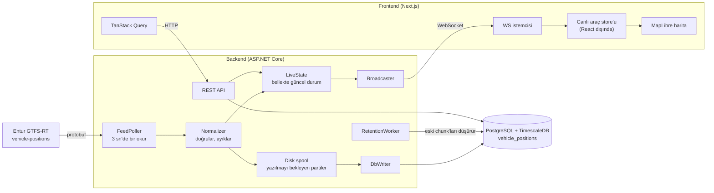
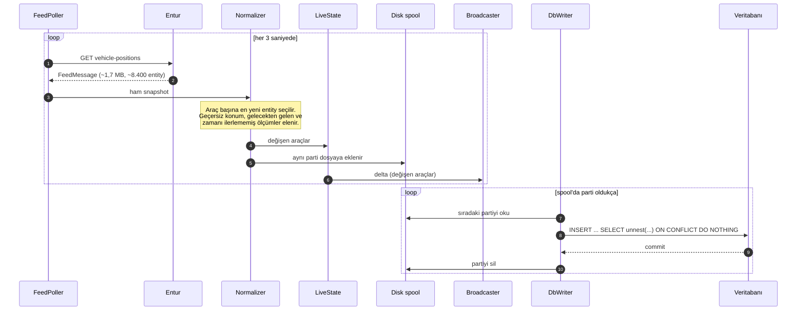
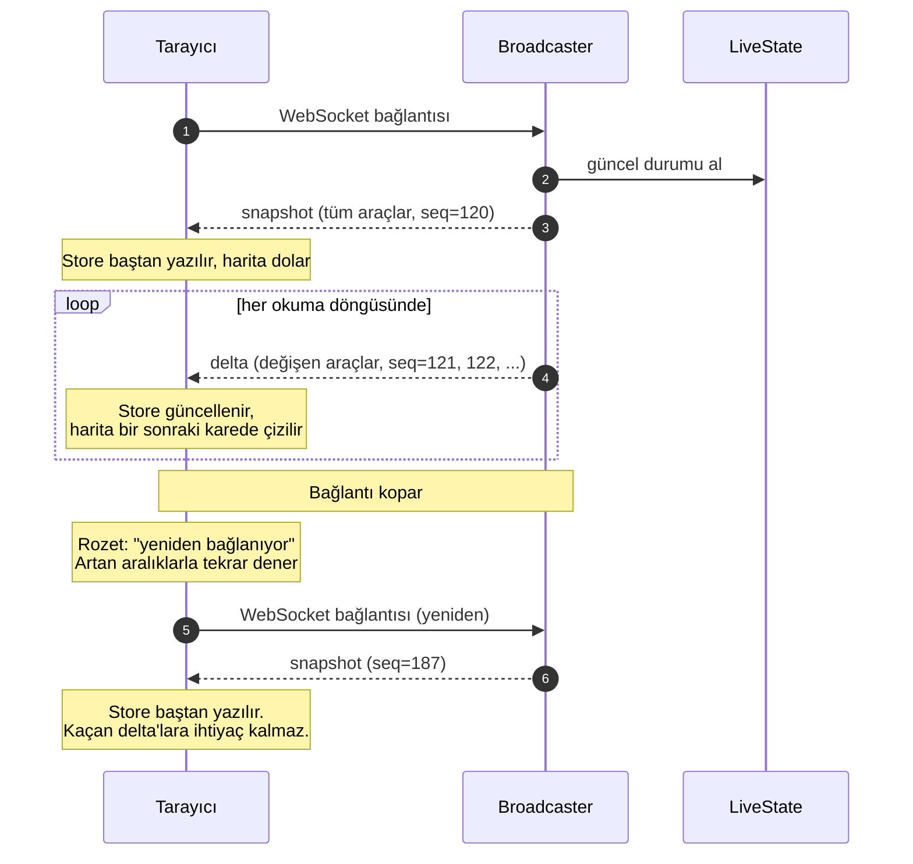
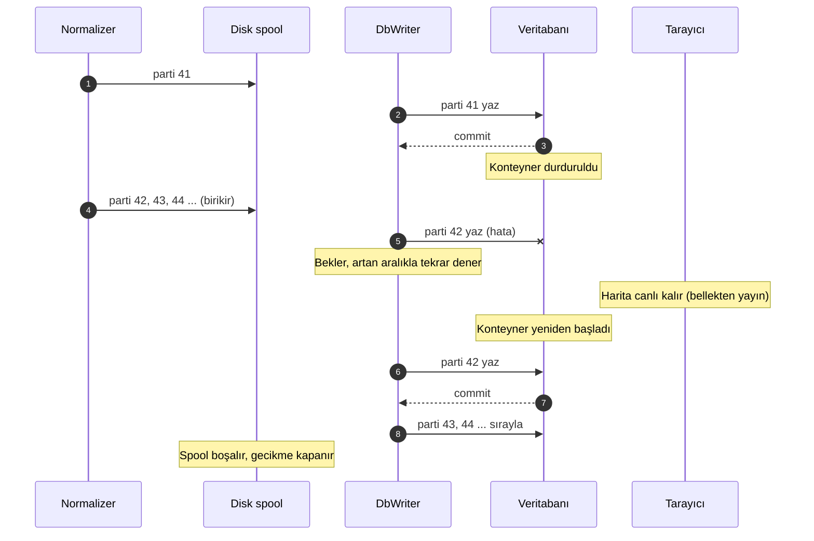
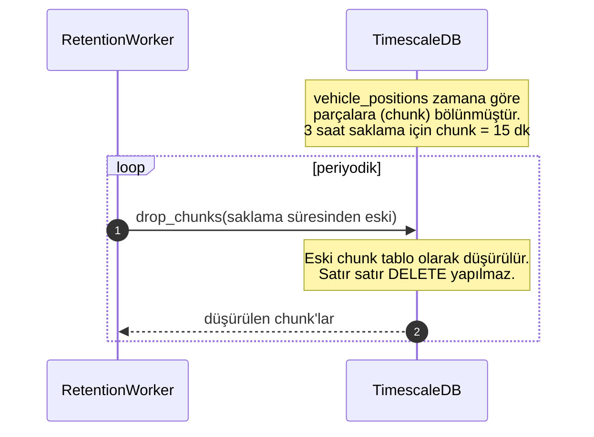
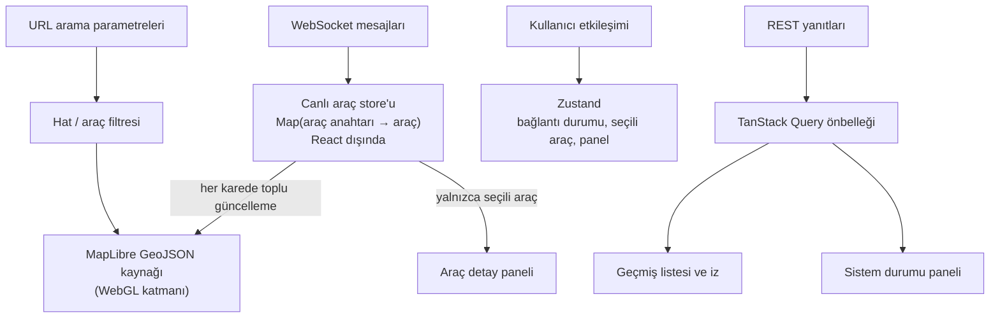

# Canlı Araç Takip Platformu — Mimari ve Veri Akışı

> Akışların adım adım çizimleri. Genel bakış, gözlemler ve ölçümler için [README](../README.md)'ye bakın.
> Diyagramlar Mermaid ile yazıldı: GitHub'da ve VS Code Markdown önizlemesinde çizim olarak görünür.

## 1. Tek cümleyle

Backend, Entur'un araç konum akışını 3 saniyede bir okur; değişen ölçümleri hem bellekteki güncel duruma hem de (önce diske, sonra veritabanına) yazar; güncel durumu WebSocket ile tarayıcıya yayınlar. Arayüz bu yayını haritada gösterir, geçmişi ve sistem durumunu REST ile sorar.

## 2. Büyük resim



Verinin iki ayrı yolu var ve birbirlerini beklemezler:

- **Canlı yol:** Normalizer → LiveState → Broadcaster → tarayıcı. Tamamen bellekte, veritabanına dokunmaz.
- **Kalıcı yol:** Normalizer → disk spool → DbWriter → veritabanı.

Bu ayrım sayesinde veritabanı durduğunda harita canlı kalır, bir istemci yavaşladığında da yazma etkilenmez.

## 3. Bileşenler ve sorumlulukları

| Bileşen | Tek işi | Katman |
|---|---|---|
| `FeedPollingWorker` | Zamanlayıcıyla akışı çeker, başarı/hata sayar | Infrastructure (arka plan servisi) |
| `SnapshotNormalizer` | Akıştan gelen kayıtları doğrular, araç başına en yeni konumu seçer | Application |
| `InMemoryLiveState` | Araç başına en son konumu bellekte tutar | Application arayüzü, Infrastructure uygulaması |
| `FilePositionSpool` | Veritabanına henüz yazılmamış partileri dosyada saklar | Infrastructure |
| `PositionWriterWorker` | Spool'daki partileri sırayla veritabanına yazar | Infrastructure (arka plan servisi) |
| `RetentionWorker` | Saklama süresini aşan veriyi siler | Infrastructure (arka plan servisi) |
| `VehicleSocketHub` | Değişiklikleri bağlı istemcilere dağıtır | Api |
| REST API | Anlık durum, geçmiş, sistem durumu | Api |

Katman bağımlılığı tek yönlüdür: `Api → Infrastructure → Application → Domain`. `Domain` hiçbir şeye bağlı değildir.

## 4. Akış 1 — Bir okuma döngüsü



Dikkat edilecek noktalar:

- Akıştaki ~8.400 entity yaklaşık 3.400 araca ait; aynı araç gün içinde yaptığı her sefer için ayrı entity olarak durur. Bu yüzden anahtar `codespace:vehicle.id`'dir ve araç başına en yeni zaman damgalı entity kullanılır.
- Entur arkada birden çok sunucudan yanıt verir; ardışık iki okumada zaman geriye gidebilir. "Zaman damgası ilerlemediyse yok say" kuralı bunu çözer.
- Her okumada tüm entity'ler değil, yalnızca konumu gerçekten yenilenen araçlar satır olur.
- Parti veritabanına **commit edildikten sonra** spool'dan silinir. Arada çökme olursa parti yeniden yazılır; `(vehicle_key, recorded_at)` benzersiz anahtarı çift kaydı engeller.

## 5. Akış 2 — WebSocket: bağlanma, canlı güncelleme, yeniden bağlanma



Neden kayıpsız: yayın "olay" değil **durum** taşır. İstemci kopukken neyi kaçırdığını bilmek zorunda değildir; yeni snapshot zaten her aracın son halini içerir.

## 6. Akış 3 — Yavaş istemci

```mermaid
sequenceDiagram
    autonumber
    participant H as VehicleSocketHub
    participant O as Giden kutusu (yavaş istemci)
    participant C as Yavaş tarayıcı
    participant D as Diğer tarayıcılar

    H->>O: değişiklik 21 (araç A, B)
    H->>D: değişiklik 21
    Note over C: Okumuyor; gönderim döngüsü bekliyor
    H->>O: değişiklik 22 (araç A, C)
    H->>D: değişiklik 22 (gecikme yok)
    Note over O: Kuyruk büyümez: bekleyenler<br/>"araç başına son konum"da birleşir<br/>(A: 22'deki hali, B, C)
    C->>O: okumaya devam eder
    O-->>C: tek delta, fromSeq=21 toSeq=22
    Note over H,C: Tek bir mesajı 15 sn alamazsa bağlantı kapatılır;<br/>yeniden bağlanınca snapshot alır
```

Her istemcinin kendi giden kutusu ve kendi gönderim döngüsü vardır. Yayıncı yalnızca giden kutularına (belleğe) yazar, hiçbir soketin gönderimini beklemez; bu yüzden biri yavaşlayınca ne diğerleri ne de veri toplama etkilenir.

Giden kutusu bir mesaj kuyruğu değil, "bu istemciye henüz gönderilmemiş durum"dur. Bu yüzden yavaş bir istemcinin bellekteki maliyeti en fazla araç sayısı kadardır ve yetiştiğinde geride kaldığı her şeyi değil, tek bir birleşik delta alır.

Yeni bağlanan istemcide de bir yarış vardır: snapshot alınırken bir değişiklik yayınlanırsa kaçabilir. Bunu önlemek için snapshot'ın alınması ve istemcinin listeye eklenmesi, yayınla aynı kilit altında yapılır; snapshot'a zaten girmiş bir değişiklik sonradan gelirse sıra numarasından tanınıp atlanır.

## 7. Akış 4 — Veritabanı durup yeniden başlıyor



## 8. Akış 5 — Saklama ve silme



Satır satır `DELETE` milyonlarca satırı tek tek işaretler, tabloyu şişirir ve vacuum yükü yaratır. Chunk düşürmek ise bir dosyayı kaldırmak gibidir: süresi veri miktarından bağımsızdır ve yazma/okuma yapan sorguları bekletmez.

## 9. Veri kaybı senaryoları

| Senaryo | Ne olur | Kayıp |
|---|---|---|
| Veritabanı birkaç dakika kapalı | Partiler diskte birikir, veritabanı dönünce yazılır | Yok |
| Uygulama yeniden başlar | Spool'da kalanlar tekrar yazılır, çift kayıt oluşmaz; güncel durum veritabanından ve ilk okumadan kurulur | Yok (yalnızca kapalı kalınan sürede okunamayan konumlar) |
| Entur erişilemez veya bozuk yanıt | Okuma başarısız sayılır, döngü devam eder | **Var:** o aralıktaki ara konumlar geri getirilemez; akış geçmişi yeniden sunmuyor. Kaynak dönünce güncel durum eksiksiz gelir |
| İstemci bağlantıyı koparır | Yeniden bağlanır, snapshot alır | Yok |
| İstemci çok yavaş okur | Bekleyen değişiklikler araç başına son konumda birleşir; yetişince tek delta alır | Yok (ara kareleri görmez, son durumu görür) |

## 10. Frontend'de veri nerede durur



| Veri türü | Nerede | Neden |
|---|---|---|
| Canlı araç konumları | React dışında bir store | Saniyede binlerce güncelleme React render'ı tetiklememeli |
| Geçmiş, sistem durumu | TanStack Query | Sunucu verisi: önbellek, sayfalama, periyodik yenileme hazır gelir |
| Bağlantı durumu, seçim, panel | Zustand | Küçük, arayüze ait durum |
| Filtre | URL | Sayfa yenilenince ve bağlantı paylaşılınca korunmalı |

## 11. Sunumda sorulabilecek sorular

- Neden TimescaleDB, neden Redis değil?
- Chunk boyu neden saklama süresinin on ikide biri?
- Bir kayıt en az ve en fazla ne kadar saklanır?
- Saklama süresi 10 güne çıksa ne değişir?
- Spool dosyası dolarsa veya disk biterse ne olur?
- Neden SignalR yerine düz WebSocket?
- İstemci neden kaçırdığı delta'ları istemiyor da baştan snapshot alıyor?
- Aynı araç neden akışta birden çok kez geçiyor, hangisini seçiyorsun?
- Toplu yazmada neden EF Core ya da `COPY` değil de `unnest`?
- Geçmiş sayfalamasında neden `OFFSET` kullanmıyorsun?
- Canlı veriyi neden Zustand'da ya da TanStack Query'de tutmuyorsun?

Bunların kısa cevapları yukarıdaki bölümlerde var; takıldığın yeri sor, birlikte derinleştiririz.
