# Canlı Araç Takip Platformu: Mimari ve Veri Akışı

> Akışların adım adım çizimleri. Genel bakış, gözlemler ve ölçümler için [README](../README.md)'ye bakın.
> Diyagramlar Mermaid ile yazıldı; GitHub'da ve VS Code Markdown önizlemesinde çizim olarak görünür.
> Adlar koddaki sınıf adlarıdır, böylece bir kutudan doğrudan dosyaya gidilebilir.

## 1. Tek cümleyle

Backend, Entur'un araç konum akışını 3 saniyede bir okur. Yeni konumları önce diske, oradan veritabanına yazar; bellekteki canlı durumu günceller ve her tarayıcıya yalnızca abone olduğu alandaki ya da hatlardaki değişiklikleri WebSocket ile gönderir. Uyarı ve sefer akışları 30 saniyede bir okunup bellekte tutulur. Hat ve durak adları ile güzergahlar Journey Planner'dan gelir. Arayüz giriş ister; canlı veriyi haritada gösterir, geçmişi, uyarıları, gecikmeyi ve sistem durumunu REST ile sorar.

## 2. Büyük resim

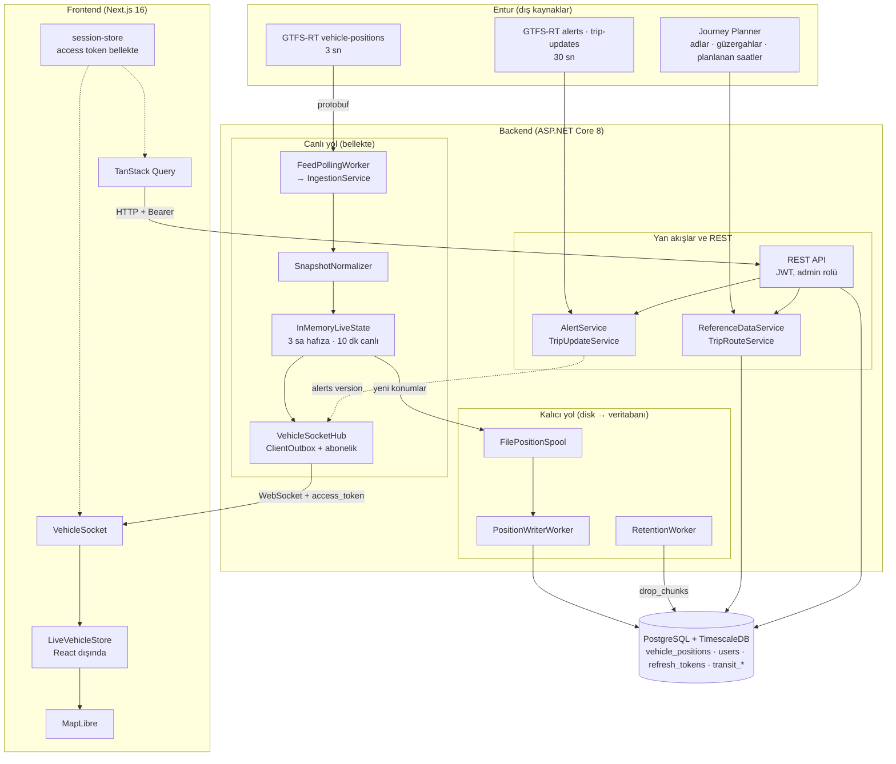

Verinin iki ayrı yolu var ve birbirlerini beklemezler:

- **Canlı yol:** normalizasyon → canlı durum → istemcilerin giden kutusu. Tamamen bellekte; veritabanına dokunmaz.
- **Kalıcı yol:** yeni konumlar önce diske (`FilePositionSpool`), oradan veritabanına yazılır.

Bu ayrım sayesinde veritabanı durduğunda harita canlı kalır, bir istemci yavaşladığında da yazma etkilenmez.

## 3. Bileşenler ve sorumlulukları

| Bileşen | Tek işi | Katman |
|---|---|---|
| `FeedPollingWorker` | Araç akışını 3 sn'de bir okutur; bir döngü hata verse de döngü sürer | Infrastructure |
| `EnturFeedSource` | HTTP + protobuf. Süre sınırı yanıt gövdesini de kapsar (yarıda donan bağlantı takılmaz) | Infrastructure |
| `IngestionService` | Bir okuma döngüsü: oku → ayıkla → canlı duruma uygula → diske yaz → yayınla | Application |
| `SnapshotNormalizer` | Araç başına en yeni konumu seçer; kimliksiz, zamansız, koordinatı geçersiz ve gelecekten gelen kayıtları eler | Application |
| `InMemoryLiveState` | 3 saatlik pencerede araç başına son konumu **hatırlar** (tekrar kaydetmemek için); son 10 dakikada bildirenleri **canlı** sayar | Application arayüzü, Infrastructure uygulaması |
| `FilePositionSpool` | Veritabanına yazılmamış partileri dosyada tutar (`.tmp` yaz + atomik yeniden adlandırma) | Infrastructure |
| `PositionWriterWorker` | Spool'u sırayla veritabanına yazar; hata olursa 1 → 15 sn aralıklarla yeniden dener | Infrastructure |
| `RetentionWorker` | Saklama süresini aşan chunk'ları düşürür | Infrastructure |
| `DatabaseInitializer` | Açılışta migration'ları ve chunk aralığını uygular, canlı durumu veritabanından geri yükler | Infrastructure |
| `VehicleSocketHub` / `VehicleSocketSession` | Değişiklikleri istemcilere dağıtır; her istemcinin kendi giden kutusu, gönderim döngüsü ve aboneliği var | Api |
| `AlertService`, `TripUpdateService` | Uyarı ve sefer akışlarını bellekte değişmez bir liste olarak tutar; okuyucular kilit almaz | Application |
| `ReferenceDataService`, `TripRouteService` | Hat/durak adlarını toplar ve saklar; sefer güzergahlarını önbellekler (Journey Planner) | Application |
| `AuthService` | Kayıt, giriş, refresh rotation ve çalınma tespiti, çıkış | Application |
| REST API | Araçlar, geçmiş, uyarılar, sefer güzergahı ve gecikmesi, sistem durumu, auth | Api |

Katman bağımlılığı tek yönlüdür: `Api → Infrastructure → Application → Domain`. Kural mimari testleriyle zorlanır; Application ne Infrastructure'ı ne ASP.NET'i ne de JWT kütüphanelerini tanır.

## 4. Akış 1: Bir okuma döngüsü

**a) Her 3 saniyede: oku, ayıkla, uygula, diske yaz, yayınla**

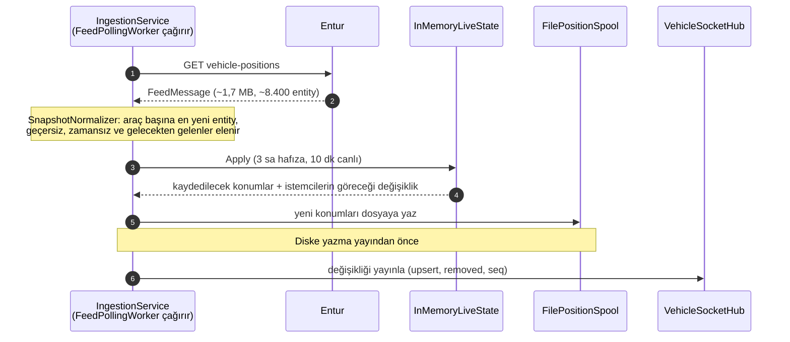

**b) Ayrı bir döngüde: diskten veritabanına**

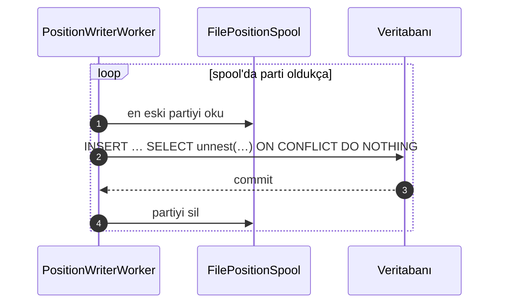

Dikkat edilecek noktalar:

- Akıştaki ~8.400 entity yaklaşık 3.400 araca ait; aynı araç günün her seferi için ayrı entity olarak durur. Anahtar `codespace:vehicle.id`'dir, araç başına en yeni zaman damgalı entity kullanılır.
- Entur arkada birden çok sunucudan yanıt verir; ardışık iki okumada zaman geriye gidebilir. "Zaman damgası ilerlemediyse yok say" kuralı bunu çözer.
- **Diske yazma yayından önce** yapılır: bir istemcinin gördüğü her konum sonradan geçmişte de bulunur.
- Parti **commit edildikten sonra** spool'dan silinir. Arada çökme olursa parti yeniden yazılır; `(vehicle_key, recorded_at)` birincil anahtarı çift kaydı engeller.
- Okuma başarısız olursa (`FeedReadException`: bağlantı yok, 503, bozuk protobuf, zaman aşımı) hiçbir şey değişmez, sayaç artar, 3 sn sonra yeniden denenir.

## 5. Akış 2: Canlı pencere ve açılış

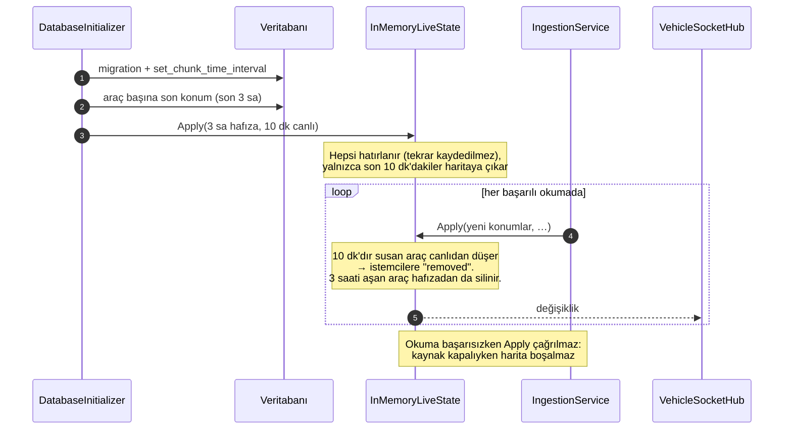

- **Neden iki pencere:** seferi biten araçlar akışta saatlerce kalıyor (Vy'nin araç kimliği aslında sefer kimliği). Tek, 3 saatlik bir pencere haritanın yarısını hayalet araçlarla dolduruyordu. Canlılığı 10 dakikaya indirip saklamayı 3 saatte bırakmak, hem haritayı temizler hem de veri kaybetmez: 10 dakikadan eski ama henüz kaydedilmemiş bir konum (ör. kesintiden sonra) yine kaydedilir.
- **Neden 10 dakika:** normal bildirimlerin %99,9'u 220 sn içinde; ölçülen en uzun gerçek sessizlik 8,5 dk (Follobanen tüneli).

## 6. Akış 3: WebSocket, abonelik ve yeniden bağlanma

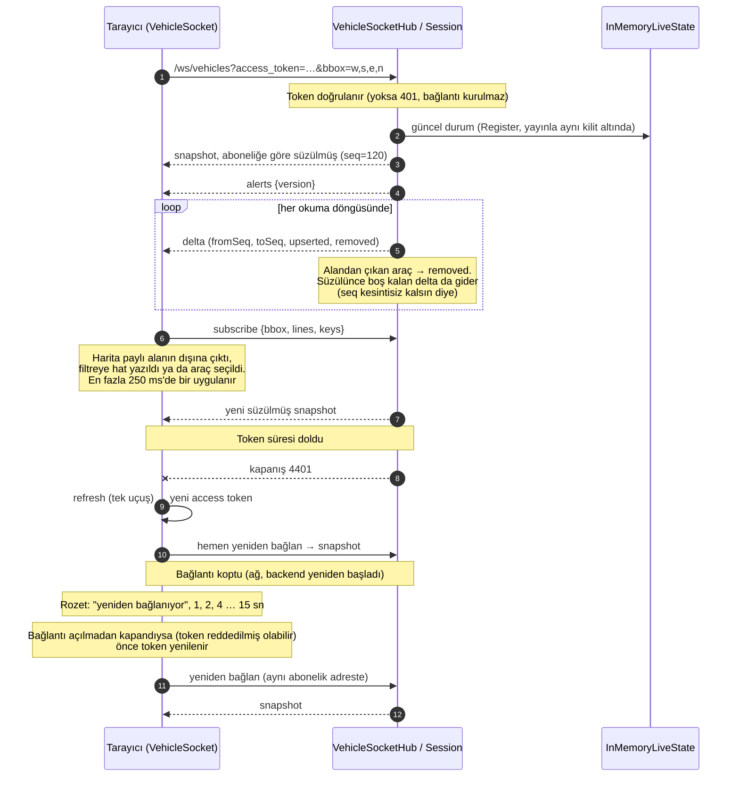

- **Neden kayıpsız:** yayın olay değil **durum** taşır. Yeniden bağlanan istemci neyi kaçırdığını bilmek zorunda değil; yeni snapshot her aracın son halini içerir.
- **Abonelik kuralı:** sabitlenmiş araç (`keys`) her zaman gelir; değilse hat listesi doluysa yalnızca o hatlar; değilse alan varsa alandakiler; hiçbiri yoksa hepsi. Filtre boşken görünen alan (her yönde yarım ekran payla), filtre bir hatla eşleşiyorsa o hatlar, seçili araç her zaman.
- **Token yenileme:** imza anahtarı backend her açıldığında yeniden üretilebildiği için yeniden başlatmadan sonra eski token geçersiz olur; tarayıcı WebSocket'te 401'i göremez. Bu yüzden açılmadan kapanan bir bağlantıdan sonra token yenilenir; canlı veri backend hazır olduktan ~0,5 sn sonra geri gelir.

## 7. Akış 4: Yavaş istemci

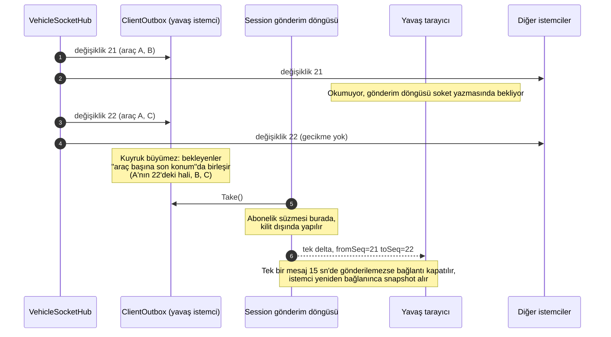

Her istemcinin kendi giden kutusu ve kendi gönderim döngüsü vardır. Yayıncı yalnızca giden kutularına (belleğe) yazar, hiçbir soketin gönderimini beklemez; bu yüzden biri yavaşlayınca ne diğerleri ne de veri toplama etkilenir. Giden kutusu bir mesaj kuyruğu değil, "bu istemciye henüz gönderilmemiş durum"dur: yavaş istemcinin bellekteki maliyeti en fazla araç sayısı kadardır.

Yeni bağlanan istemcide de bir yarış vardır: snapshot alınırken bir değişiklik yayınlanırsa kaçabilir. Bunu önlemek için snapshot'ın alınması ve istemcinin listeye eklenmesi, yayınla aynı kilit altında yapılır; snapshot'a zaten girmiş bir değişiklik sonradan gelirse sıra numarasından tanınıp atlanır. Abonelik değişince yeni snapshot da aynı kilit altında sıraya konur.

## 8. Akış 5: Veritabanı durup yeniden başlıyor

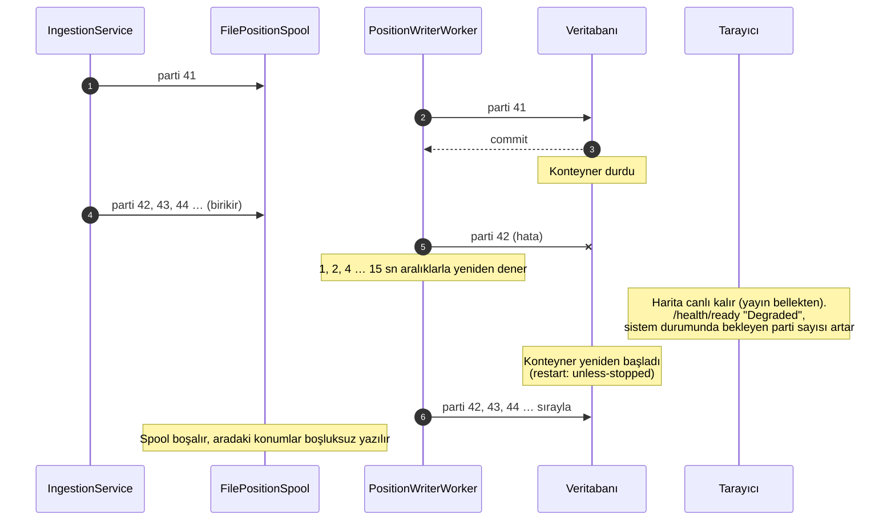

Denendi: 45 sn'lik kesintide 8 parti birikti ve ~4 sn'de boşaldı. Docker ana makinesi yeniden başlatıldığında backend açıldı ama veritabanı açılmadı; backend 13 partiyi tampona yazdı ve veritabanı başlatılınca kayıpsız boşalttı. Bundan sonra veritabanına da `restart: unless-stopped` eklendi.

## 9. Akış 6: Saklama ve silme

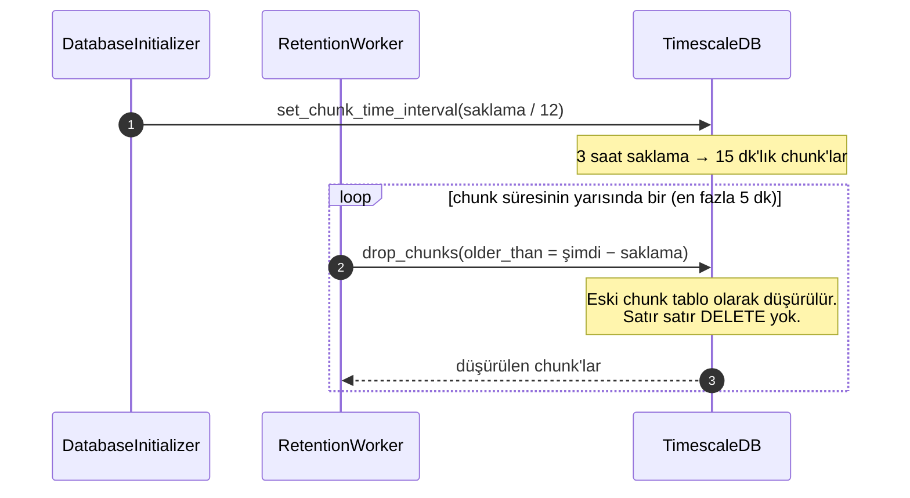

Satır satır `DELETE` milyonlarca satırı tek tek işaretler, tabloyu şişirir ve vacuum yükü yaratır. Chunk düşürmek bir dosyayı kaldırmak gibidir: süresi veri miktarından bağımsızdır ve yazma ya da okuma yapan sorguları bekletmez. Bir chunk ancak tamamı pencerenin dışına çıkınca düşer; bu yüzden en eski kayıt 3 saatten en fazla bir chunk ve bir tarama aralığı kadar eski olabilir.

## 10. Akış 7: Kimlik doğrulama

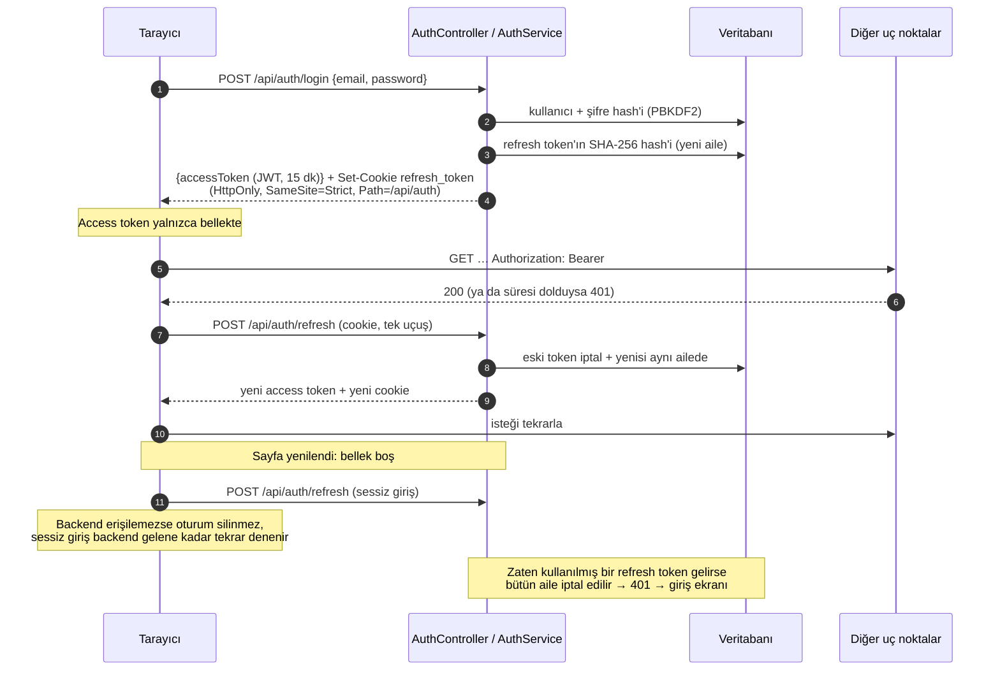

- **Kapsam:** varsayılan politika "giriş yapmış kullanıcı"; işaretlenmeyi unutulan bir uç nokta da kapalı kalır. Açık olanlar: giriş/kayıt/refresh/çıkış, `/health`, `/health/ready`, Swagger. `GET /api/status` yalnızca `admin`.
- **Kaba kuvvet:** yalnızca başarısız girişler sayılır (adres başına 5 dk'da 10).
- **Admin hesabı:** açılışta yapılandırmadan oluşturulur (`AdminSeeder`).

## 11. Akış 8: Uyarılar ve sefer takibi

**a) Uyarılar**

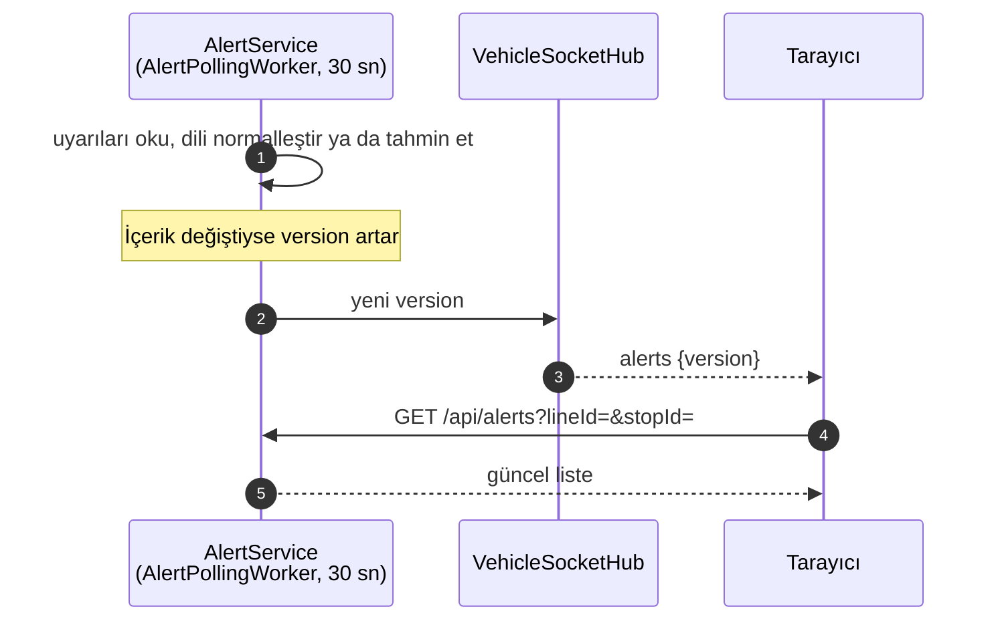

Uyarıların %60'ı yalnızca sefer adı verdiği için, hat filtresinin çalışması amacıyla her seferin hattı Journey Planner'dan bir kez sorulur (önbellekli, en fazla 4 paralel istek).

**b) Sefer takibi**

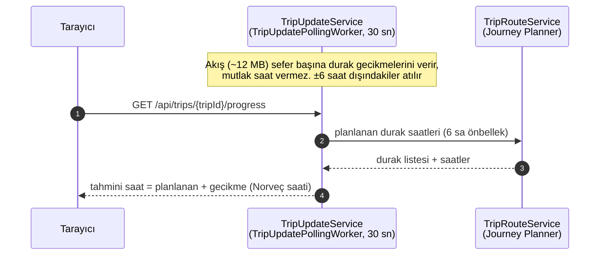

## 12. Veri kaybı senaryoları

| Senaryo | Ne olur | Kayıp |
|---|---|---|
| Veritabanı birkaç dakika kapalı | Partiler diskte birikir, veritabanı dönünce sırayla yazılır | Yok |
| Uygulama yeniden başlar | Spool'da kalanlar tekrar yazılır, çift kayıt oluşmaz; canlı durum veritabanından ve ilk okumadan kurulur; tarayıcılar kendiliğinden yeniden bağlanır | Kapalı kalınan sürede okunamayan ara konumlar |
| Entur erişilemez, bozuk ya da yarıda donan yanıt | Okuma başarısız sayılır, döngü sürer; harita son durumu korur | **Var:** o aralıktaki ara konumlar geri getirilemez, akış geçmişi yeniden sunmuyor. Kaynak dönünce güncel durum eksiksiz gelir |
| İstemci bağlantıyı koparır | Yeniden bağlanır, aboneliğine göre süzülmüş snapshot alır | Yok |
| İstemci çok yavaş okur | Bekleyenler araç başına son konumda birleşir; yetişince tek delta alır; 15 sn'de bir mesajı alamazsa kapatılır | Yok (ara kareleri görmez, son durumu görür) |
| Disk tamponuna yazılamaz (disk dolu) | O döngünün konumları haritada görünür ama veritabanına girmez | **Var** (bilinen eksik: tamponun üst sınırı yok) |

## 13. Frontend'de veri nerede durur

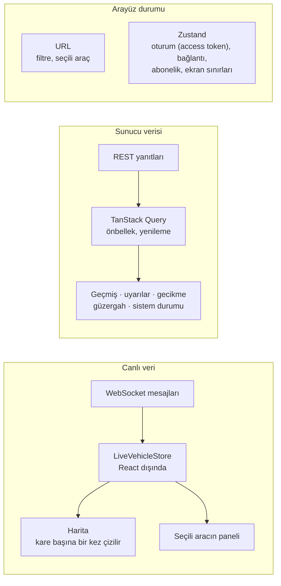

Üç alan birbirinden bağımsızdır ve aralarındaki bağlantılar küçüktür: WebSocket'ten gelen `alerts {version}` uyarı sorgusunu yeniden çektirir; harita hareketi ve filtre, Zustand'daki aboneliği değiştirir, abonelik de WebSocket'e `subscribe` olarak gider; access token hem REST isteklerine hem WebSocket bağlantısına eklenir.

| Veri türü | Nerede | Neden |
|---|---|---|
| Canlı araç konumları | React dışında bir store | Birkaç saniyede bir binlerce konum değişiyor; React render'ını tetiklememeli |
| Geçmiş, uyarılar, gecikme, güzergah, sistem durumu | TanStack Query | Sunucu verisi: önbellek, sayfalama, periyodik yenileme hazır gelir |
| Bağlantı durumu, abonelik, ekran sınırları | Zustand | Küçük, arayüze ait durum |
| Access token | Zustand, yalnızca bellekte | Kalıcı bir yerde durmaz; yenilemede HttpOnly cookie'den geri gelir |
| Filtre, seçili araç | URL | Sayfa yenilenince ve link paylaşılınca korunmalı |
